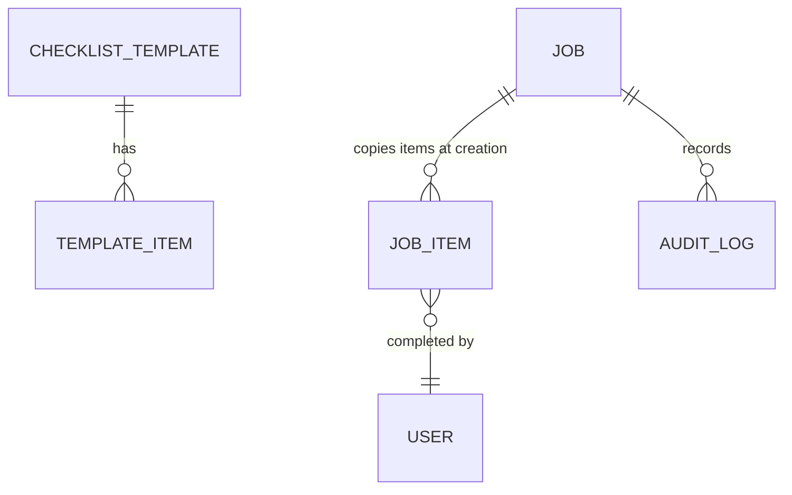

# Template / Instance Data Modeling

**Problem:** checklists, forms and process definitions change over time. If every record points at the live template, editing the template silently rewrites history.

**Pattern:** keep *templates* (what to do) and *instances* (what happened) in separate tables, and **copy** the template into the instance when work starts.

## Rules of thumb

- An instance stores the **text and rules it was created with**, plus an optional reference to the template for reporting.
- Changing a template affects only **future** jobs.
- Status changes are written as **new audit rows**, not edits, so durations and bottlenecks can be computed later.
- Derived values (an overall status, a latest date) are computed from the items, not typed twice.

## Payoff

Reports stay truthful over time, audits can reproduce exactly what an operator saw, and template editors can improve things without fear.
